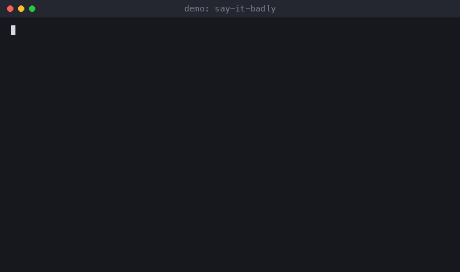

# say-it-badly

**You dictated it wrong. Your agent should understand anyway.**




Talking to a coding agent is faster than typing, but every request arrives with the mistakes of a speech recognizer: wrong names, glued words, a missing "not". Agents usually react in one of two ways. They quote the mistake back and ask what you meant, or they take it literally and do the wrong thing.

This is a drop-in rule file that fixes both. Fix the meaning first, ask only when a wrong guess would cost real money or real data.

## Before and after

What was dictated:

> hey can you deploy the pine cone shop checkout fix no wait dont push yet just commit it and uh bump the version to one point four oh

Without the rule, the agent asks: "Did you mean *Pinecone Shop*? Do you want me to push or not? What is 'one point four oh'?"

With the rule:

> Understood as: commit the checkout fix in `pinecone-shop`, don't push, version 1.4.0.
>
> Committed. Version bumped to 1.4.0. Not pushed.

The agent states its reading in one line and gets to work.

## What it fixes

- Names: "pine cone" becomes `pinecone`. The agent matches by sound against your project list and your glossary.
- Numbers: "one point four oh" becomes `1.4.0`.
- Glued and split words: "get hub" is GitHub, and "dev ops" and "devops" are the same word.
- Punctuation: dictation puts commas anywhere. Two requests can fuse into one sentence, and one can split in two. The agent reads for intent, not for periods.
- Fragments: the start of a sentence got eaten, or a stray word hangs at the end. The agent works with what's there.
- Negations: handled carefully, because a wrong guess here does the most damage. See the next section.

## When it must still ask

Fixing typos silently is fine, but guessing on something expensive is not. The agent stops and asks one short question, with options, when the request involves:

- money: amounts, plans, paid API calls ("fifteen" and "fifty" sound alike)
- production: deploys, migrations, restarts of live services
- deletion: files, branches, tables, accounts
- sending anything outside: email, messages, public posts, anything a stranger will read
- a negation it can't resolve: "push" and "don't push" differ by one syllable and have opposite results
- two equally likely readings: two projects that sound alike, two accounts, two domains

Before using a spoken value in an irreversible step (a domain, an amount, an email address, an ID), the agent checks it against the source of truth: the config, the dashboard, the database. It doesn't trust what the microphone heard.

## Works with

Wispr Flow, macOS dictation, Whisper-based tools, phone voice typing, or anything else that turns speech into text. The agent never needs to know which one. It only needs to know that the input may be noisy.

## Install

Copy one file into your agent's instructions.

```bash
curl -o rules/voice-input.md --create-dirs https://raw.githubusercontent.com/nickspiz/say-it-badly/main/rules/voice-input.md
```

Then reference it from your `CLAUDE.md` or `AGENTS.md`:

```markdown
Requests are dictated by voice. Follow rules/voice-input.md.
```

You can also install it as a Claude Code plugin, where the rule is a skill:

```text
/plugin marketplace add nickspiz/say-it-badly
/plugin install say-it-badly@say-it-badly
```

Or paste the contents of the rule straight into the file. Optionally copy `templates/glossary.md` and fill in your own project names so the agent stops guessing.

## Example prompts

- "deploy the pine cone shop fix no wait dont push just commit it"
- "bump the version to one point four oh"
- "delete the old branch, not the main one"

## What's inside

```
rules/voice-input.md            the drop-in rule
skills/voice-input/SKILL.md     the same rule as a plugin skill
templates/glossary.md           example glossary with made-up names
```

## Questions and ideas

Have a question or an idea? Start a [discussion](https://github.com/nickspiz/say-it-badly/discussions). For bugs, open an [issue](https://github.com/nickspiz/say-it-badly/issues/new/choose). See [CONTRIBUTING.md](CONTRIBUTING.md) before sending a pull request.

## Privacy

The plugin is one skill, a plain text rule about reading dictated requests. It has no scripts and no hooks. The plugin itself reads no files, calls nothing and makes no network requests. It writes nothing and sends nothing to the author. It only changes how Claude interprets what you type. Whatever Claude does afterwards happens through the tools and permissions you already have in your session, as it would without this plugin.

## Support

Questions or bugs: [GitHub Issues](https://github.com/nickspiz/say-it-badly/issues) or hello@nickspiz.com.

## License

MIT. See [LICENSE](LICENSE).
